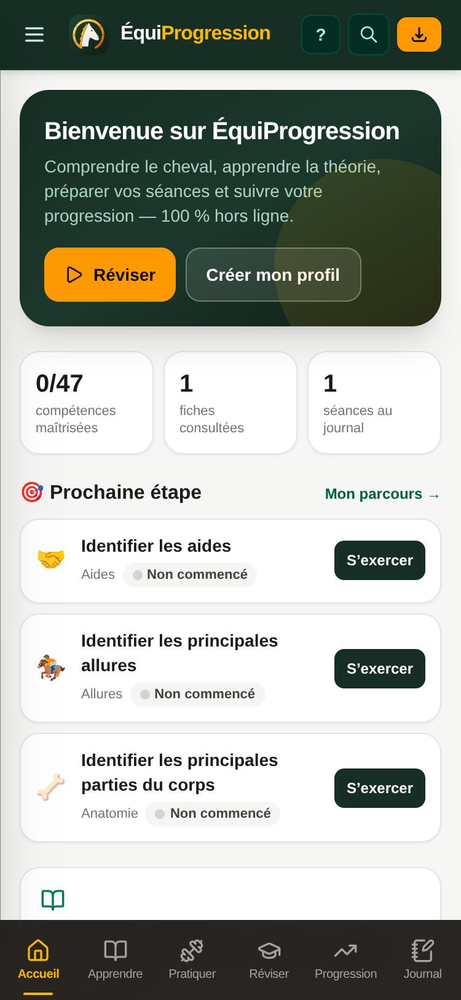
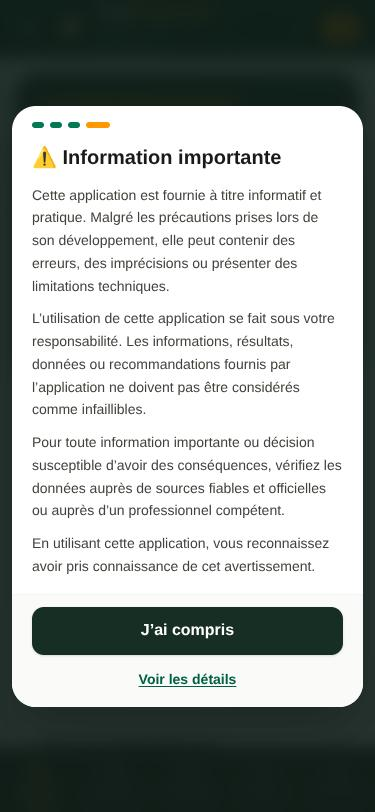
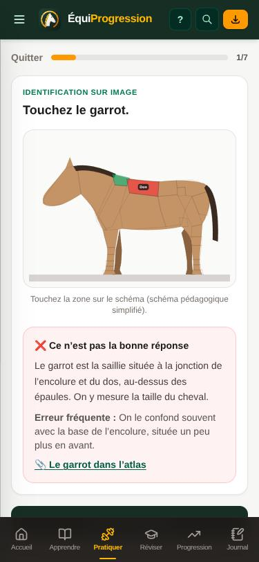
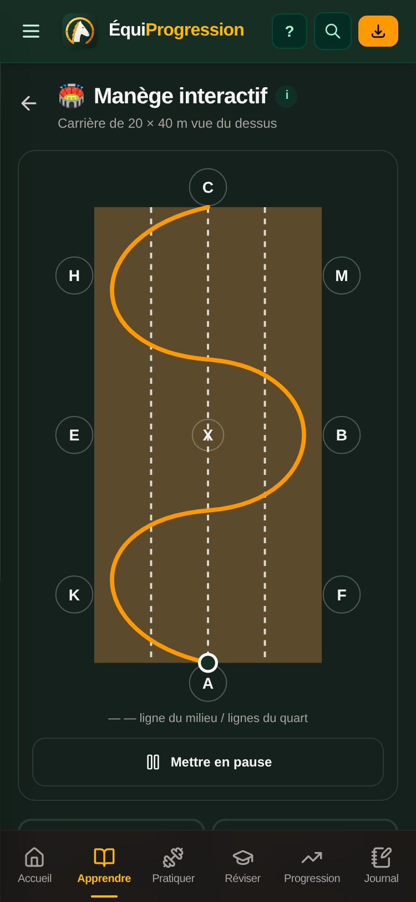
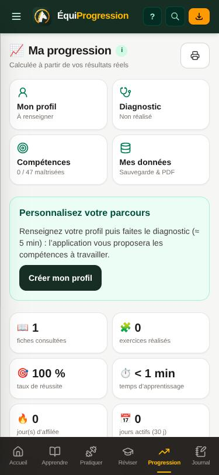
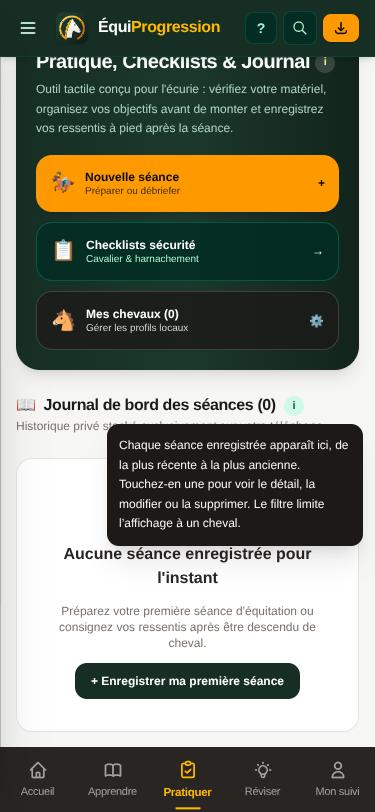
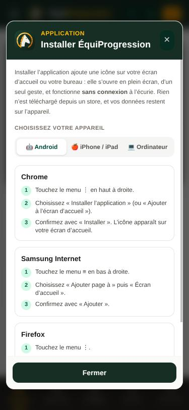

<div align="center">


# Equitor

**La plateforme d’apprentissage équestre qui tient dans la poche — comprendre, s’exercer, réviser, préparer et suivre sa progression. 100 % locale, 100 % hors ligne.**


[Fonctionnalités](#-fonctionnalités) · [Captures](#-captures-décran) · [Installation](#-installer-lapplication) · [Développement](#%EF%B8%8F-développement) · [Changelog](CHANGELOG.md)

</div>

---

## 🐎 Présentation

**Equitor** est une Progressive Web App mobile, entièrement en français, pour **apprendre**, **réviser** et **suivre sa pratique** de l’équitation, à l’écurie comme à la maison. Elle s’appuie sur les principes de l’équitation classique, de la biomécanique équine et de l’échelle de progression du dressage.

> [!NOTE]
> Aucune inscription, aucun serveur : vos chevaux, séances et progrès restent **sur votre appareil**.

## 📸 Captures d’écran

<table>
  <tr>
    <td align="center"><br /><sub><b>🏠 Accueil</b></sub></td>
    <td align="center"><br /><sub><b>👋 Onboarding</b></sub></td>
    <td align="center"><br /><sub><b>⚠️ Information importante</b></sub></td>
  </tr>
  <tr>
    <td align="center"><br /><sub><b>🧩 Exercices interactifs</b></sub></td>
    <td align="center"><br /><sub><b>🏟️ Manège animé · mode sombre</b></sub></td>
    <td align="center"><br /><sub><b>📈 Ma progression</b></sub></td>
  </tr>
  <tr>
    <td align="center"><br /><sub><b>💬 Aide contextuelle</b></sub></td>
    <td align="center"><br /><sub><b>ℹ️ Infobulles</b></sub></td>
    <td align="center"><br /><sub><b>📲 Installer l’application</b></sub></td>
  </tr>
</table>

## ✨ Fonctionnalités

| | Espace | Ce que vous pouvez faire |
|---|---|---|
| 🏠 | **Accueil** | Prochaine étape de votre parcours, révisions du jour, reprise de lecture, séance préparée, favoris. |
| 📚 | **Apprendre** | 24 fiches, 18 modules, **parcours personnalisé**, termes cliquables vers le dictionnaire. |
| 🏋️ | **Pratiquer** | 41 exercices, **10 types de questions**, préparation de séance (8 modèles + bilan), checklists modifiables. |
| 💡 | **Réviser** | **Répétition espacée** (1-3-7-14-30 jours, adaptée à vos résultats), 42 cartes mémoire. |
| 📈 | **Ma progression** | Profil, **diagnostic** (13 domaines), **47 compétences** avec maîtrise mesurée, statistiques réelles, objectifs. |
| 📓 | **Mon journal** | Séances détaillées, recherche et filtres, **fiches chevaux** avec photo et historique, analyse. |
| 🗂️ | **Ressources** | **Dictionnaire** (108 termes), **atlas anatomique** (5 vues, 40 régions), **atelier du matériel**, **manège interactif** animé, **comportement du cheval**. |

### 🧩 Transversal
- 🔍 **Recherche globale** hors ligne : fiches, termes, exercices, compétences, journal, chevaux, programmes — accents et fautes de frappe tolérés.
- ⭐ **Favoris et notes** sur les fiches, termes, exercices, séances et ressources.
- 💾 **Sauvegarde JSON** versionnée avec empreinte d’intégrité, restauration avec récapitulatif, fusion ou remplacement ; **exports PDF** (fiche, bilan, séances, programme, révision).
- 🌙 **Mode sombre** (clair / sombre / automatique), ♿ accessibilité (clavier, lecteurs d’écran, focus visible).
- 🔄 Migration automatique et **sans perte** des données de la version 1.

### 🧭 Prise en main pour les novices
- 👋 **Onboarding de premier lancement** : présentation de l’application en 3 étapes, puis avertissement légal à valider.
- 💬 **Aide contextuelle par écran** : affichée automatiquement à la première visite de chaque onglet, puis à tout moment via le bouton **?** de l’en-tête.
- ℹ️ **Infobulles** sur les sections clés de chaque écran (toucher sur mobile, survol sur ordinateur).
- 📲 **Bouton « Installer l’App »** toujours visible : installation en un clic quand le navigateur le permet, sinon guide pas à pas pour Android, iPhone / iPad et ordinateur.

### ☰ Menu & système
- **Menu hamburger** regroupant toutes les fonctionnalités par catégorie (Général, Apprendre, Pratiquer, Réviser, Suivi & données, Aide & informations, Système).
- **Paramètres système** : version, date de sortie, dernière vérification, boutons « Vérifier les mises à jour » et « Forcer la mise à jour ».
- 🔄 **Mises à jour automatiques** en arrière-plan, appliquées sans jamais interrompre une saisie.

### ⚖️ Mentions légales
- Avertissement et **limitation de responsabilité** acceptés au premier lancement (mémorisés localement).
- Écran **Mentions légales** accessible en permanence : menu ☰ → *Aide & informations*, ou *Paramètres système*.

## 🔒 Principes non négociables

1. **100 % local & zéro cloud** : ni base distante, ni compte, ni backend, ni API d’IA, ni traceur.
2. **Stockage sur l’appareil** : IndexedDB (Dexie.js) pour les données, `localStorage` pour les préférences.
3. **Hors ligne intégral** : Service Worker + Cache Storage via `vite-plugin-pwa`.
4. **Propriété intellectuelle** : fiches, schémas et quiz sont des créations originales.
5. **Sécurité & bien-être animal** : les fiches avancées rappellent l’obligation d’un encadrement qualifié.

## 📲 Installer l’application

Ouvrez l’application dans votre navigateur puis touchez **⬇ Installer l’App** en haut de l’écran.

| Appareil | Navigateur | Marche à suivre |
|---|---|---|
| 🤖 Android | Chrome | Menu **⋮** → *Installer l’application* |
| 🍎 iPhone / iPad | Safari | **Partager** → *Sur l’écran d’accueil* |
| 💻 Ordinateur | Chrome / Edge | Icône d’installation dans la barre d’adresse |

## 🛠️ Développement

```bash
npm ci                           # installer les dépendances
npm run dev                      # serveur de développement (port 3000)
npm run build                    # build de production PWA (dist/)
npm run preview                  # prévisualiser le build
npm test                         # 69 tests unitaires, d’intégration et de contenus + invariants légaux
npm run test:e2e                 # 12 parcours de bout en bout (Playwright, mobile)
npm run lint                     # vérification TypeScript
npm run icons                    # régénérer les icônes PWA depuis public/logo.svg
npm run landing:build            # landing page de présentation (landing/dist)
npm run landing:test             # vérifications statiques et navigateur de la landing
```

> [!TIP]
> Pour rejouer le premier lancement en développement : **Paramètres système → 🛠️ [DEV] Réinitialiser les mentions légales et l’onboarding** (bouton absent en production).

### 🗂️ Structure

```
src/
├── app/           routeur (#/…), fenêtres globales, thème
├── components/    navigation, menu ☰, recherche, kit d’interface, graphiques, schémas interactifs
├── data/          contenus originaux : compétences, exercices, dictionnaire, atlas, matériel, manège…
├── features/      écrans : accueil, fiches, exercices, révisions, progression, journal, préparation, ressources
├── services/      stockage (IndexedDB + migrations), sauvegarde, progression, révisions, recherche, stats, PDF
├── legal/ onboarding/ pwa/ hooks/ types/
└── tests/         unitaires, intégration, contenus
landing/           landing page statique de présentation (projet Cloudflare Pages distinct)
scripts/           e2e.mjs (Playwright), check-legal.ts, generate-icons.mjs, landing-*.mjs
```

### ☁️ Déploiement Cloudflare Pages
- **Application** : build `npm ci && npm run build` · dossier de sortie `dist` · aucune variable d’environnement.
- **Landing page** (projet Pages distinct) : build `npm ci && npm run landing:build` · dossier de sortie `landing/dist` · variable facultative `LANDING_URL`. Détails : [`docs/LANDING.md`](docs/LANDING.md).

## 📂 Documentation

| Document | Contenu |
|---|---|
| 📘 [`docs/GUIDE_UTILISATEUR.md`](docs/GUIDE_UTILISATEUR.md) | Prise en main pas à pas |
| ✨ [`docs/FONCTIONNALITES.md`](docs/FONCTIONNALITES.md) | Description de chaque module |
| 🏗️ [`docs/ARCHITECTURE.md`](docs/ARCHITECTURE.md) | Architecture, flux de données, déploiement |
| 🗃️ [`docs/SCHEMA_DONNEES.md`](docs/SCHEMA_DONNEES.md) | Tables IndexedDB, modèles, migrations |
| 📶 [`docs/STRATEGIE_HORS_LIGNE.md`](docs/STRATEGIE_HORS_LIGNE.md) | Service Worker, cache, mises à jour |
| 💾 [`docs/SAUVEGARDE_RESTAURATION.md`](docs/SAUVEGARDE_RESTAURATION.md) | Format, vérifications, fusion, PDF |
| 🧪 [`docs/TESTS.md`](docs/TESTS.md) | Stratégie et résultats des tests |
| 🔍 [`docs/AUDIT_INITIAL.md`](docs/AUDIT_INITIAL.md) | Audit de la version 1.2 |
| 🌿 [`docs/LANDING.md`](docs/LANDING.md) | Landing page : architecture, déploiement, correspondance textes ↔ fonctionnalités |
| 📘 [`CONTEXT.md`](CONTEXT.md) | Règles du projet et mécanismes clés |
| 📝 [`CHANGELOG.md`](CHANGELOG.md) | Historique des versions |
| 📖 [`docs/referentiel-pedagogique.md`](docs/referentiel-pedagogique.md) · ©️ [`docs/droits-auteur.md`](docs/droits-auteur.md) · ⚠️ [`docs/securite-pedagogique.md`](docs/securite-pedagogique.md) | Contenus, droits d’auteur, sécurité |


---

<div align="center">
<sub>Édité par <b>Swinux</b> · Canton de Vaud, Suisse · <a href="mailto:contact@swinux.ch">contact@swinux.ch</a></sub><br />
<sub>Application fournie à titre informatif : elle ne remplace pas l’enseignement d’un professionnel diplômé.</sub>
</div>
